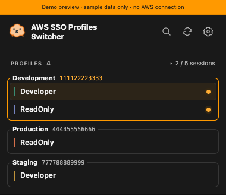
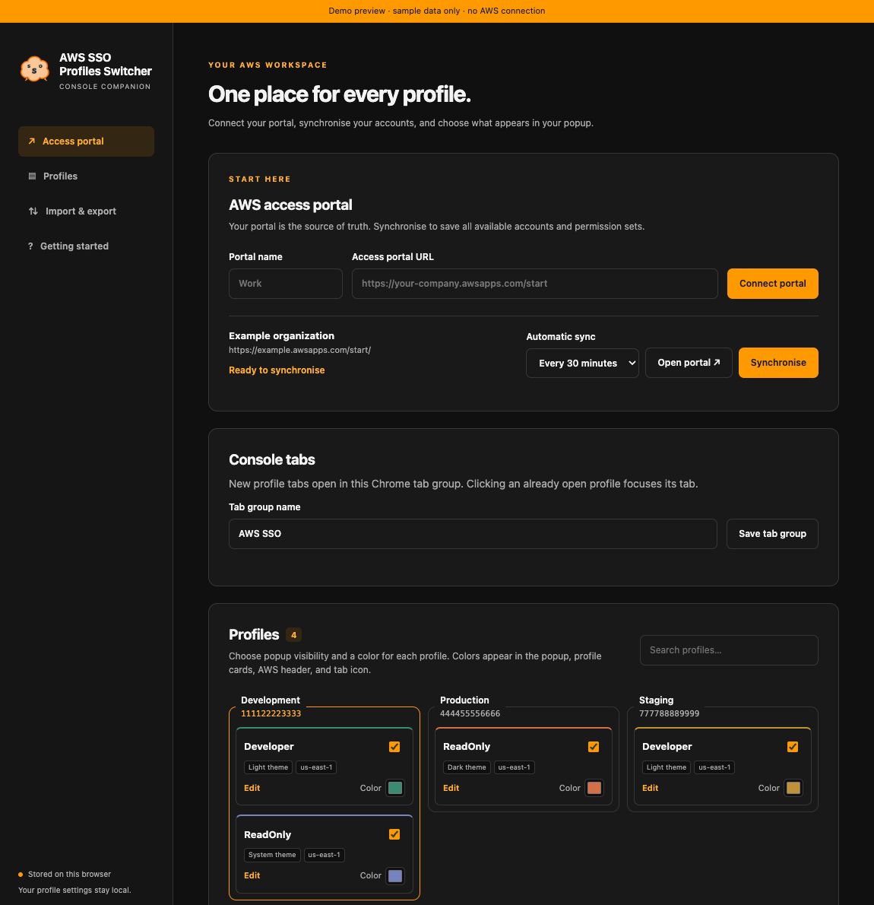
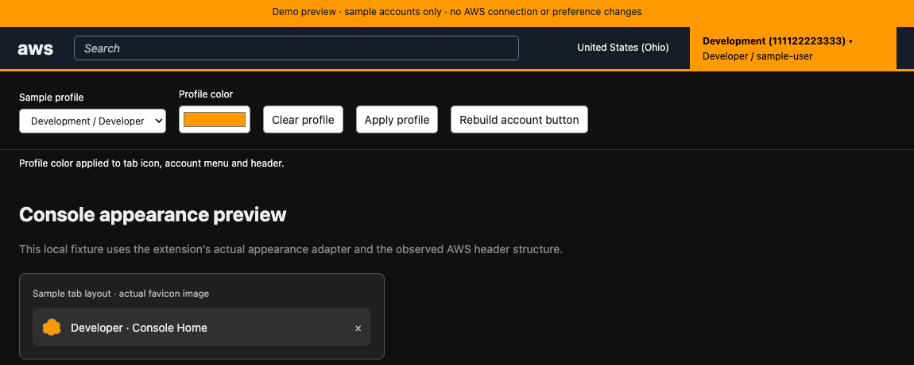

# AWS SSO Profiles Switcher

Find your AWS IAM Identity Center accounts and permission sets, switch between
open consoles, and give each profile a distinct theme and color. The extension
uses your regular AWS access portal sign-in.

**Version** 1.0.0 · Chrome 114+

## Install locally

You need **Chrome 114 or later** and **Node.js 20 or later** with npm.

1. [Download the source ZIP](https://github.com/chayneps/aws-sso-profiles-switcher/archive/refs/heads/main.zip),
   extract it, and open a terminal in the extracted folder. To use Git, run
   these commands.

   ```sh
   git clone https://github.com/chayneps/aws-sso-profiles-switcher.git
   cd aws-sso-profiles-switcher
   ```

2. Build the extension from that folder.

   ```sh
   npm ci
   npm run build
   ```

3. In Chrome, enter `chrome://extensions` in the address bar. Enable
   **Developer mode**, choose **Load unpacked**, and select the generated
   **`dist`** folder. It contains the bundled files and `manifest.json`.
4. Open Chrome’s **Extensions** menu and pin **AWS SSO Profiles Switcher**.
   Open the extension, choose **Manage profiles** (the gear icon), and paste
   your AWS access portal URL. Choose **Connect portal** and complete your
   usual sign-in and MFA if prompted. The extension imports your profiles
   automatically.

To update an unpacked installation, rebuild in the same checkout, click
**Reload** on the extension card, and refresh any AWS console tabs you already
have open. See [Chrome’s unpacked extension guide](https://developer.chrome.com/docs/extensions/get-started/tutorial/hello-world#load-unpacked).

## Feature tour

These screenshots use sample accounts from the local preview.

### Switch profiles and see active sessions

Search by account name, account number, or permission set. Click a profile
to focus its existing console tab or open a new one in your configured Chrome
tab group. The orange dot identifies an active AWS session. Click the session
count to see the session list. Enable AWS multi-session to keep multiple
identities open together.



### Sync your portal and organise profiles

Connect a portal in **Manage**, then use **Synchronise** to refresh your
accounts and permission sets. Choose which profiles appear in the popup, drag
account headers to reorder them, and set each profile’s color, theme, label,
and preferred region.



### Recognise the AWS console at a glance

A matched console uses your profile color for the account control, the thin
strip across the top, and the thought-cloud tab icon. Choose **Light**,
**Dark**, or **System** for supported console pages. The screenshot uses the
extension’s actual appearance adapter on a sample console header.



## Connect and synchronise your portal

Opening the extension shows cached profiles without starting portal sync or
prompting for sign-in. With no portal configured, the popup opens Manage and
focuses the access-portal URL field. Use the circular-arrow toolbar icon to
synchronise; if multiple portals are configured, choose one in the panel that
opens. Portal setup and detailed sync settings live in Manage. A readable open
Accounts page clears a stale saved sign-in warning without starting sync.
Reconnect appears only for observed sign-in/expiry UI; unconfirmed sync failures
offer Retry. Chrome host-permission failures offer Grant access.

1. Open **Manage**. **AWS access portal** is the first setup section.
2. Enter your portal URL and an optional name, then choose **Connect portal**.
   Grant Chrome access to that portal's origin. Connecting starts the first sync.
3. The extension opens a portal tab. Complete your normal Microsoft/SSO sign-in
   and MFA if prompted. Synchronisation resumes when the Accounts page returns.
4. Every discovered account/permission-set pair is saved automatically. There is
   no separate preview or Save selected profiles step.
5. In **Profiles**, use **Show in popup** to choose your shortcuts. All profiles
   remain in Manage, including ones hidden from the popup.

Use **Synchronise** in Manage or the circular-arrow icon in the popup to refresh manually. Automatic sync
checks for updates approximately every 30 minutes while Chrome runs. Choose
15 minutes, 30 minutes, hourly, or Manual only beside the portal. Chrome can delay
alarms while the computer is asleep; this is not a background service when Chrome
is closed. **Manual only** disables periodic profile sync too. Opening the popup
or Manage never requests a new sync; connecting a new portal still starts its
initial sync.

Manual sync reuses an open tab for the selected portal. If it needs a new tab,
it opens it in the Chrome tab group named under **Manage → Console tabs**.
Sync clears filters, returns to page one, expands rows, and reads available
account/permission-set links. Scheduled sync uses a background tab and closes it
after success if it is inactive. Tabs that need sign-in stay open, with a
**Sign in & synchronise** action in Manage. A normal portal navigation can renew
an existing SSO sign-in; Microsoft credentials/MFA are completed by you. Failed
access pauses repeated automatic attempts until you reconnect. The extension
never reads identity-provider pages or stores credentials.

Themes, labels, account order, regions, and Show in popup choices survive sync and
extension reload. A partial or failed sync keeps previous profiles. Only a
complete sync marks absent assignments as not present and excludes them from the
popup; their settings remain available if access returns. New profiles are shown
by default. Your persistent catalog is a cache of the portal, not an independent
source of AWS permissions.

## Open and distinguish accounts

The popup and Manage page group roles by account. Each bordered group shows the
account name and number once in its legend; tiles show the permission set or your
custom label. Account borders and numbers are muted; accounts with a detected
active session use orange, including sessions for hidden roles. Role rows stay compact. Searching by
account number still works. Saved drag order is the only account-ordering rule;
roles use alphabetical order. Legacy pin flags are ignored.

**Enable AWS multi-session to keep different profiles open together.** If an open
console explicitly reports it is disabled, the extension shows setup help and
blocks new federation until it is enabled. Already-matched tabs can still be
focused. Use **Open AWS console**, enable it in AWS's account menu, and Recheck.

The extension checks open console pages for AWS's documented account/session
hostname or visible Enable/Disable multi-session controls. It checks again before
every launch and every 30 seconds while the popup or Manage page is visible.
Healthy and inconclusive status are hidden. No open console, an unreadable page,
or an unrecognized UI is **unknown**, not disabled: tiles remain clickable so the
first console can open. A valid native session URL supplies positive evidence
even if an old page cannot yet be injected. A session takes precedence over stale
Enable controls on another landing page. There is no saved confirmation checkbox, cookie access, or automatic change
to AWS preferences. The check observes page evidence, not a server-side setting;
stale pages and future AWS UI changes can require a console refresh and Recheck.

- Click the magnifying-glass toolbar icon to search by account name, ID, label,
  or permission set. Ctrl/Command+K or `/` also opens search. Saved account order applies.
  Use arrow keys and Enter to navigate, or click a profile. Escape clears search,
  collapses the field, then closes the popup. The gear icon opens Manage.
- Open **Profile color** on each card in Manage to choose Red, Yellow, Green or
  Blue, or one of four shared custom slots. Click + to set a custom slot with the
  native picker; click a saved swatch to reuse it, or its pencil to edit it.
  The same chooser is available in Edit. Colors mark its card,
  popup entry, matched console header, and the tab's favicon. Matched
  AWS console tabs replace their icon with the main thought-cloud shape in the saved profile color;
  the original icon returns when the profile no longer matches. Sign-in tabs
  keep their native icon. Colors survive sync, reload, and JSON
  export/import. Use **Edit** for theme, label, and preferred region.

In Manage, the checkbox at the top right controls popup visibility; hover it
for its description. Edit and Color share the bottom row. Double-click
a profile tile to open it, or focus the tile and press Enter. Account names wrap
in full with their numbers below. Account groups pack into columns, reading from
top to bottom, so accounts with more roles do not leave large gaps in other columns.

Drag an account's name/number header to rearrange its whole group in either the
popup or Manage. Drop in the upper/lower half of another group to place it before
or after that account. Both views share the saved order, with no pinned sections
or priority overrides. You can also focus a header and use **Alt+↑/↓**. Filtering
does not delete hidden accounts from the saved order; sync/reload keep it intact.

- New profile tabs open in an orange **AWS SSO** Chrome tab group. Change its name
  under **Manage → Console tabs**. The group is reused within each window.
- The extension searches current console tabs and rechecks the exact account and
  permission set before focusing one, including after the observation cache was
  lost. Repeated clicks during the same pending SSO launch focus its existing tab.
  It expands the tab's group and focuses its window; an existing manually grouped
  tab stays in its own group. Grouping failures keep the opened tab and report a
  warning, so retrying does not create duplicates.
- AWS native **multi-session** supports up to five active
  identities; the extension may save many more profiles. Follow the
  [AWS multi-session guide](https://docs.aws.amazon.com/awsconsolehelpdocs/latest/gsg/multisession.html).
- This uses your existing Identity Center sign-in. It does not isolate independent
  Microsoft users or replace AWS's authentication, session expiry, or session cap.

Themes are applied locally to recognized AWS/Cloudscape page roots. The selected
profile color also fills AWS's account button and draws a thin line across the
console header; its text uses black or white for contrast. This overrides the
native inner account-color strip locally, so roles in the same account can use
different colors. It restores native styling if the identity no longer matches
and reapplies after AWS replaces the header. Reload the extension and refresh
existing console tabs after building.

The native AWS account menu shows the account and permission set; no floating
profile box is added. The topmost AWS color strip matches the profile color. Some service pages, nested
components, and embedded frames may retain native styling. The extension does
not save global AWS appearance preferences. Unknown or ambiguous identities are
left unstyled; an identical account/role listed under multiple portals is ambiguous.

## Manage active AWS sessions

The popup shows the detected session count out of AWS's five-session limit on
the same line as PROFILES and its catalog count.
An orange dot at the end of a profile row indicates an existing native AWS session.
Hover or keyboard-focus the dot to reveal ×, then click to sign out that session.
This affects all tabs for that session; it does not delete the saved profile.
Closing uses AWS's own exact session sign-out link in a temporary background tab.
Your working tabs stay open. Errors remain in the popup. The count drops only
after a fresh AWS registry confirms removal; an unconfirmed request stays counted.
Chrome may prevent confirmation after the last session signs out because the
extension cannot read the sign-in site. Temporary tabs are cleaned up either way.
Click the session count to open a floating list, including sessions whose profiles
are hidden or unsaved. It overlays the tiles without moving them. Escape, clicking
outside, or the close button dismisses it; long session lists scroll within it.
At capacity, opening a new identity shows a close-session prompt. Existing tabs
and existing native sessions can still be opened. In-flight sign-ins reserve slots.
The list refreshes on popup open/focus and every 30 seconds while visible, without
synchronising the portal. With no readable native registry, the count is marked
“detected”; it may omit sessions that AWS still retains. AWS enforces the final limit.

## Import/export configuration

Manage → Import & export accepts exported JSON and AWS SSO INI configuration,
including `[sso-session name]` references and legacy inline SSO fields. Review the
preview before applying. Matching IDs take imported configuration preferences;
other existing profiles remain. IAM assume-role entries without an SSO assignment
cannot be converted automatically. Files are read only when you select them.

Export JSON contains configuration, not credentials. Treat account names and IDs
as internal information when sharing an export. Back up JSON before uninstalling,
because Chrome removes local extension storage when the extension is removed.

## Privacy and permissions

- `storage`: save profile configuration locally and temporary sync/tab state.
- `alarms`: periodically check whether a configured portal is due for sync.
- `tabGroups`: name, reuse, and expand the Chrome group containing profile tabs.
- `scripting`: inject the portal scanner after permission and recheck console
  identity before focusing a tab.
- AWS console host access: identify profiles and apply page-local appearance.
- Optional portal host access: requested for the specific portal you configure.

No backend, analytics, remote scripts, cookie access, token extraction, credential
storage, Microsoft host access, or AWS resource changes. The persisted schema
contains account/role metadata and appearance only. The importer does not collect
account email addresses, even though the portal displays them.

## Development and checks

```sh
npm test          # Core, portal DOM, appearance, background coordinator
npm run build    # Produces dist and validates packaged assets
npm run preview  # Sample-data UI at http://127.0.0.1:4173/options.html
```

Popup preview: `http://127.0.0.1:4173/popup.html`. The banner clearly identifies
sample data. The preview uses the real UI modules with a mock Chrome transport;
it does not connect to AWS or prove installed extension behavior. Preview data
is separate from extension storage. Set `SSO_PREVIEW_PORT` to change the port.
Console accent preview: `http://127.0.0.1:4173/console-preview.html`. It exercises
the actual appearance adapter with sample accounts and a local header fixture;
it does not connect to AWS or change account-wide color settings.

Runtime source is under `src/`; fixtures/tests are under `tests/`; build and
preview tools are under `scripts/`. `scripts/demo.js` is never packaged in `dist`.

## Chrome/AWS smoke test still required

1. Load `dist`; confirm no extension errors and grant access to your portal.
2. Synchronise from the authenticated Accounts page and compare the saved accounts
   and permission sets with the portal.
3. Hide one profile, change its appearance, and synchronise again; confirm both preferences survive. Reload the extension and verify the entire catalog remains.
4. With only the access portal open, verify that unknown multi-session status
   leaves tiles clickable. Enable multi-session in AWS for simultaneous accounts;
   an explicit disabled result should block new federation. A readable Accounts
   page should clear a stale reconnect warning without starting a sync.
5. Open two native multi-session console identities, assign light/dark separately,
   and verify native account identity, header accents, tab icons, and service-page appearance while navigating.
6. Restart the extension worker; confirm the saved catalog remains and existing
   console tabs are rechecked. Expire/sign out a session through normal AWS UI
   when convenient and verify AWS handles reauthentication.
7. Choose a group name in Manage → Console tabs. Open two profiles and verify
   they join the same group; click each again to focus its existing tab without
   creating another. Confirm different roles in one account stay distinct.

If sync reports no rows, use **Sign in & synchronise** and complete portal sign-in.
If host access was removed, use **Synchronise** to grant it again. Partial syncs
keep existing data; inspect the reported errors and retry. If a theme does not apply, confirm the full
account/permission-set match and refresh the console. Some services and embedded
frames may retain their own theme. GovCloud and China partitions are outside this MVP.

## Attribution

The compact picker takes inspiration from [AWS Extend Switch Roles](https://github.com/tilfinltd/aws-extend-switch-roles).
See [third-party notices](THIRD_PARTY_NOTICES.md), the [specification](docs/SPEC.md),
the [design](docs/DESIGN.md), and the [validation notes](docs/VALIDATION.md).
This is an independent project.
