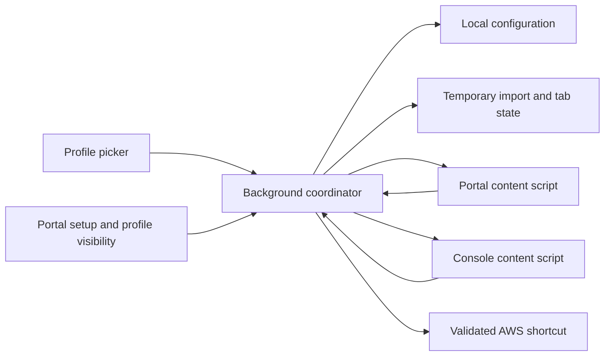

# AWS SSO Profiles Switcher — technical and interface design

## Session inventory (v1)

`core/console-sessions.js` reads current identity and native other-session tiles,
including their session URLs and permission-set identifiers. A registry is complete
only when its stated session count matches unique parsed session keys. Background
`sessions.js` prefers the newest loaded complete registry, falling back to
readable console observations. It maps exact account/permission identities to
profiles, and preserves unknown identities for occupancy. State is transient.

The worker returns `sessions` on UI state and periodic checks. The launcher checks
it after existing-tab reuse, before new federation; native sessions with no tab
reopen via their observed console URL. Pending launches reserve capacity for ten
minutes and are deduplicated by profile. The worker serializes mutations.

`CLOSE_SESSION` accepts a fresh inventory key from trusted extension UI only.
It opens the observed native URL in a disposable inactive tab, waits for the
native header, and revalidates session key and role on every menu attempt. The
adapter reacquires replaced nodes and opens the native split-button dropdown,
including portalled submenus. It returns only a visible AWS sign-in link whose
path is exactly `/sessions/<key>/v1/logout`, without query or fragment. It never
clicks a logout action or accepts `logoutAll` or text-only menu actions. The
background validates the returned URL again, then navigates the disposable tab.
User tabs remain open and are never navigated or focused by a close request.

A second disposable console page loads a surviving identity's fresh registry.
Removal is confirmed only by a complete registry excluding the target identity,
or, for the last session, an observable redirect from its console to AWS sign-in.
Missing metadata, partial registries, and verification failures remain explicitly
unconfirmed, with capacity retained. Chrome may hide the last-session sign-in URL
because this extension has no sign-in host permission. No new permissions were
added. Both temporary tabs are removed in a finally block, including on failure.

Confirmed closures are recorded as up to 100 key/timestamp entries in transient
`closedSessions` storage. Registries from documents loaded before closure cannot
resurrect those keys, and the launcher skips their old working tabs. New documents
loaded after confirmation can establish a reauthenticated session, even if AWS
reuses a key. Old launch ownership is removed only after confirmation. Popup
errors remain visible in the popup; requested and confirmed outcomes differ.

Closing a browser tab alone never frees a slot. Native registries can be stale or
unavailable, so AWS remains authoritative; the extension cannot prove remote
session validity using navigation DOM alone.

Status: implementation baseline. Updated: 2026-11-09.

## Architecture

Use a small MV3 extension built from modern JavaScript ES modules. Use esbuild for
bundling, Node's built-in test runner, and a DOM fixture library where needed.
Avoid a UI framework for the initial popup and options forms. This minimizes
dependencies while keeping modules independently testable.



Suggested source boundaries:

- `src/core/`: schemas, profile keys, URL normalization, INI/JSON parsing, catalog
  merging, account/role identity matching, and native theme adapter.
- `src/background/`: storage, validated messaging, import coordination, tab launch
  and recovery. Persist state instead of relying on worker-global variables.
- `src/content/`: portal discovery and console identity/appearance adapters.
- `src/ui/`: popup, options, shared components/styles, and extension API wrapper.
- `tests/`: anonymized fixtures and meaningful unit/integration tests.
- `scripts/`: reproducible build and a local fixture-based UI preview server.

Keep the UI preview harness outside the production extension. It must use obvious
sample accounts, never silently call real AWS services, and exercise the same UI
modules through an explicit mock transport.

## Data model

Store a versioned configuration object with portals, profiles, and UI preferences.

```text
Portal
  id                  canonical base URL (origin plus required portal path)
  label               optional user-provided name
  baseUrl             validated HTTPS access-portal URL
  lastImportAt        optional timestamp
  lastImportComplete  boolean
  syncIntervalMinutes 0 | 15 | 30 (default) | 60
  syncStatus          idle | syncing | synced | partial | sign-in-required | permission-required | error
  lastAttemptAt, syncMessage

Profile
  id                  stable key derived from portal + accountId + permissionSet
  portalId
  accountId           exactly 12 digits
  accountName         last observed AWS display name
  permissionSet       exact assigned permission-set name
  label               optional user override
  theme               system | light | dark
  color               validated hex accent
  region              optional validated commercial region
  showInPopup         boolean, defaults true for existing/new profiles
  lastSeenAt          optional timestamp
  availability        observed | not-seen | unknown

ObservedTab
  tabId
  profileId           assigned only after sufficiently confident identification
  accountId
  permissionSet
  sessionHost         observed session hostname, never guessed
  observedAt

ImportDraft
  jobId, portalId, tabId, status, progress
  candidates, complete, warnings, startedAt
```

Credentials, bearer tokens, cookies, account email addresses, and Microsoft profile
details are unnecessary and must not be retained. Limit data exposed to content
scripts to the configuration they need. Apply schema validation to every import
and message. Persist import drafts separately from saved profiles.

## Permissions and trust boundaries

Use `storage`, `scripting`, `alarms`, and `tabGroups`; add `activeTab` only if the implemented flow
needs it. Console content scripts match `https://*.console.aws.amazon.com/*`.
Request portal host access on a user gesture for the concrete configured origin,
using an optional host-permission declaration for supported AWS portal domains.
Avoid `cookies`, `webRequest`, `<all_urls>`, native messaging, and Microsoft host
permissions. Do not add `tabs` solely to create tabs; assess host-based URL access.

Background handlers distinguish extension UI messages from content-script messages.
Validate the sender tab, document URL, configured portal, and active import job
before accepting discoveries. Console reports must come from AWS console origins.
Reject unknown actions and malformed IDs. Treat all page labels, URLs, and config
files as untrusted data; render text with textContent, not HTML interpolation.
Use a packaged-code-only CSP and no external scripts/fonts.

## Portal synchronisation algorithm

1. `UI_OPENED` returns the cached catalog without starting portal work, or returns
   `setupRequired` so the popup opens Manage and the URL field receives focus.
   Storage events use `GET_STATE`. Explicit sync actions request host permission
   when needed; merely opening a view never prompts. Portal setup is the first panel. Connect requests origin access on a user gesture,
   persists the portal, and starts sync. Manual Synchronise uses the same coordinator.
2. A five-minute Chrome alarm selects a due portal by its persisted interval and
   last attempt. Skip manual-only, permission-required, or sign-in-required portals.
   Serialize worker actions, prohibit overlapping scans, and recreate missing alarms.
3. For manual sync, reuse an open Accounts or portal home tab for the selected
   portal. Place a new manual sync tab in the configured Chrome group. For
   automatic sync, create an inactive portal Accounts tab. Keep the tab ID in
   session connections for authentication and inject after navigation completes.
4. When the tab returns to the configured portal, inject the adapter. If it is at
   an identity-provider URL, only mark Sign-in required; never inspect that page.
5. In the sync tab, clear account filters and navigate Previous back to page one.
   Expand account disclosures, wait for all delayed roles, validate same-portal
   role links, and follow pagination with cycle detection and bounded work. Do not
   click permission-set or Access keys links. An explicit empty accounts table is
   different from unavailable access or a loading failure.
6. Validate sender frame/tab/job and every result field. Merge all candidates into
   persistent local config immediately on completion, including successful partial
   discoveries. Preserve visibility and appearance by stable ID. A cancelled or
   failed scan cannot invalidate the prior inventory. Complete absence marks an
   assignment not-seen; keep its settings and omit it from the picker.
7. For unavailable access, navigate the sync tab to the normal portal once to
   attempt SSO renewal. Then wait for normal user sign-in/MFA and resume on return.
   Scheduled retries pause while sign-in is required; manual Sign in & synchronise
   focuses/reuses the tracked tab. Keep the previous catalog throughout.
8. Close an inactive background sync tab after success. Keep manual and sign-in tabs.
   Mark stale/closed/navigated jobs interrupted and discard stale reports. Local
   sync status survives reload; session connections may be recreated on next sync.
9. Manage shows the full catalog and a per-profile Show in popup checkbox. Popup
   filtering uses that preference plus presence state, never ordering as visibility.
   Existing config version 1 migrates missing visibility to true and interval to 30.

`src/background/sync.js` owns scheduling, portal tabs, reauthentication/resumption,
merge completion, and cleanup. The worker validates messages and serializes every
entry point, including alarms and tab events. Configuration is local; credentials
and session-host observations are not added to the persisted portal catalog.

The live portal investigation expanded all 28 accounts through the browser and
verified 29 account/permission-set pairs, with asynchronous role disclosure. This
was manual DOM investigation, not an installed-extension scan. It did not establish every error,
empty-account, pagination, or alternate portal-layout behavior. Cover those cases
with fixtures and document the need for additional live compatibility checks.

Observed portal selectors and structure (2026-11-06):

- The table is an HTML `table` with `role="treegrid"`; do not assume its ARIA role
  is `table` just because an accessibility snapshot labels it that way.
- Account rows are `tr[aria-level="1"]`; their role rows follow as sibling
  `tr[aria-level="2"]` elements until the next account row.
- Account labels have `data-testid="account-list-cell"` and `role="button"`.
- Account links have `data-testid="account-federation-link"`; permission-set links
  have `data-testid="federation-link"`.
- Disclosure buttons expose `aria-expanded`. Role rows expose `aria-setsize`
  and `aria-posinset`, which can help verify all roles have loaded.
- The Access keys control has `data-testid="role-creation-action-button"` and
  must never be used for profile discovery.

## Launch and identity resolution

`core/multi-session.js` reads only the console URL and rendered multi-session
controls. The detector is self-contained for `chrome.scripting.executeScript`;
it uses no cookies, tokens, hidden application state, or undocumented AWS API.
`background/multi-session.js` queries permitted console tabs and inspects their
top frames afresh for every UI state request and launch. A documented
`<account-id>-<session-id>` hostname or visible Disable multi-session control is
positive evidence, including a URL fallback if injection fails. A visible Turn on /
Enable multi-session control is negative evidence. Positive native-session evidence
wins across tabs because old landing pages may retain opt-in controls. Other URLs
and absent/unreadable pages are unknown. Checks do not navigate or click controls.

Only an explicit disabled result blocks new federation. Unknown is inconclusive
and must not disable tiles or prevent the first console from opening. The worker
rechecks before creating a tab, while existing exact matches may always be focused.
Setup opens/focuses the ordinary console without launching
a role or changing AWS settings. Users can initially authenticate through their
portal, enable the feature in AWS, then Recheck. UI focus also refreshes the
status after returning from AWS. `ui/session-monitor.js` also checks every 30
seconds while a view is visible, skips hidden/overlapping checks, and stops on
page close. Healthy/unknown status is hidden; explicit negative evidence reveals
the setup alert. These checks never synchronise profiles.
The evidence is a page observation, not proof of
the current browser cookie preference: stale pages may need refreshing. Keep a
console open to observe status; localized labels fall back to hostname evidence.

`readPortalAccess` is a read-only probe of permitted existing portal tabs. Visible
account rows (or an explicit empty inventory) establish a rendered Accounts page;
a visible sign-in/expiry heading or alert is explicit negative evidence. Unknown
loading/network states never imply expiry. State reads reconcile stale saved
sign-in errors with a ready page, preserving profiles and last-sync timestamps.
The UI receives `portalAccess`; it offers Reconnect only for explicit sign-in
evidence, and Retry for an unconfirmed failed sync. No portal navigation, role
expansion, or identity-provider inspection is performed during this check.

`background/launch.js` searches live console tabs rather than depending on the
session observation cache. Its self-contained identity probe requires the complete
permission-set role; a session hostname can supply the account ID, but never the
role. Contradictory account IDs are rejected. Session `launches` records retain
owned pending SSO tabs for up to ten minutes, including IdP pages whose URLs are
not exposed to us; these pending requests are not used as verified identities.
An exact match is grouped/expanded and focused. New tabs join a literal-name
group in their own window (default `ui.tabGroupName = "AWS SSO"`, color orange).
Existing user-assigned groups are preserved. The `tabGroups` permission supplies
group metadata and naming, with no broad `tabs` permission. A grouping error is
reported after retaining the opened tab and pending record, avoiding duplicates.

`SET_COLOR` changes only a validated six-digit hex color on an existing profile,
then notifies console content scripts. This avoids replacing profile metadata or
visibility from an old card while portal sync is updating the catalog. Card color
pickers show the saved hex value. The existing editor uses the same color field.

Construct a fresh shortcut from validated structured fields rather than trusting
an imported arbitrary URL. The route is `#/console` with `account_id`, `role_name`,
and an optional encoded `destination` for the chosen AWS console home/region.
Preserve the portal base path and use URL/URLSearchParams for encoding.

The worker may focus a tab only when its latest observation matches both account
and permission set, with portal context when available. Recheck stale observations.
If two portals yield the same account/role and cannot be distinguished, keep the
match ambiguous. Opening another tab is safer than focusing a different identity.

Use visible AWS navigation/account information and non-secret DOM identity metadata.
Normalize `AWSReservedSSO_<permission-set>_<hash>` only when the full pattern is
valid; preserve permission-set underscores. A hostname identifies an account or
session, not necessarily a role. A pending launch alone is not proof of identity.

On the inspected Console Home page, `#nav-usernameMenu` contains the account name
and 12-digit ID in its text and the full `AWSReservedSSO_…` role in its `title`.
Its `aria-label` includes the short permission-set name. These strings also include
a user identifier: parse only account/role, never retain the complete label/title.

At worker restart recover temporary state from storage and reconcile reports from
open console tabs. At browser restart rediscover identity; discard stale tab IDs.
Expose honest statuses such as Open tab observed, Unmatched, and Sign-in needed.

## Console appearance adapter

Keep identity detection, theme capability detection, and applying appearance as
separate operations. First resolve the exact profile; then apply appearance.

Use native AWS/Cloudscape mode markers where supported, without sending preference
API requests. Detect supported DOM evidence and toggle only the relevant mode
markers. Do not claim a broad CSS filter is native dark-mode support. Keep native
account/role text and apply accessible profile accents without a floating badge.

The accent adapter marks the matched account button and `#awsc-nav-header`, then
adds a narrowly scoped stylesheet. The account button and its nested native color
strip use the profile hex color with black/white foreground selected by relative
luminance. An inset 3 px shadow adds the same header accent without a layout
shift. Child backgrounds are transparent so AWS's inner gray strip cannot obscure
the chosen color. The header's direct `role=img` child labeled `Account color:`
is the native 4 px top strip and receives the same accent. Account-button upper
corners are flat, and descendant pseudo-element shadows are suppressed: native
gray corner wings are redundant with the full-button fill. The original strip,
button corners, and pseudo shadows return when the scoped stylesheet is removed.
No AWS account customization or preference API is called.

Saved marker attributes and custom properties are restored on cleanup; the
stylesheet is removed. `isCurrent()` checks header/account/root identity and
accent markers so the content adapter reapplies after root replacement even if
the observed account/role and profile payload have not changed. Native inline
style resets are observed, while the extension disconnects its observer during
its own writes to avoid loops.

Keep original values for cleanup. Handle light/dark/system and matchMedia changes.
Use narrowly scoped, debounced mutation observers and compare before writing to
avoid self-triggered loops. Re-evaluate after navigation/root replacement; clear
styling on identity mismatch, profile deletion, or extension disconnect where
feasible. Cross-origin frames require their own compatibility work and are not
silently considered themed.

Live Console Home currently uses `awsui-visual-refresh` and
`awsui-polaris-dark-mode` on `body`; some child elements also have
`awsui-dark-mode`. Cloudscape's public `applyMode` implementation toggles
`awsui-dark-mode`. The adapter therefore needs compatibility for both mode-class
families and must not infer full page support merely from an isolated dark menu.
The inspected browser was in ordinary single-session mode. Simultaneous-theme
behavior has not yet been verified live, and this investigation did not change
AWS visual-mode or multi-session preferences.

## Interface

Use a restrained AWS-adjacent visual language: neutral backgrounds, orange action
color, generous line height, compact rows, and clear account/role hierarchy. Use
system fonts and packaged icons. Support system light/dark in extension pages.

Popup, 380 px wide with a compact 320 px layout for narrow contexts:

```text
AWS SSO Profiles Switcher                 [⌕] [↻] [⚙]
------------------------------------------------
● Development / Dev_Lower                 ☆
  Development · 111122223333
● Production / ReadOnly                   ★
  Production · 444455556666    Open tab observed
```

The first-run popup uses a short setup message and one Connect AWS portal button.
It hides the empty count and duplicate import action. Popup-specific CSS sets an
intrinsic document width so Chrome can measure the action popup without a
viewport-based body-width feedback loop. The header stays on one line; the search
field expands from the magnifying-glass action and owns its focus border. The
other icons synchronise profiles or open Manage. A portal chooser appears only
when manually syncing one of multiple portals. There is no footer or permanent
portal/status row. Healthy multi-session status is hidden; only problems and
active sync progress use space above the profiles. Keyboard navigation remains
available with the search field collapsed.

Options page:

- Portal setup first, with a named URL, Connect/Synchronise, automatic interval,
  Open portal, last-sync timestamp, and reconnection status.
- A multi-session prerequisite card before profiles, visible only for explicitly disabled
  status, with Open AWS console / Recheck actions. That state blocks new federation;
  unknown state permits launch. Configuration and portal sync remain available.
- Console tabs settings provide the group name for new profile tabs.
- Automatic saving with progress, completeness warnings, Cancel, and counts. No
  save-selection step; Show in popup controls visibility in the full profile catalog.
- Searchable profile list with compact Profile color buttons and hex tooltips;
  editor with label, account, permission set, theme, color, and region controls.
- Both views collect roles in account fieldsets. The legend intersects the border
  and holds the account name and number once. Tiles use role/custom-label titles
  without repeated account IDs; Manage keeps its per-role controls inside them.
- Explicit JSON/INI import and JSON export; display validation errors before save.
- Compatibility/privacy information and a linked native multi-session guide.

Use semantic labels, clear focus rings, keyboard-operable controls, live status
announcements, and adequate contrast. Color supplements identity text. Keep user
flows free of internal implementation terms.

`groupProfilesByAccount` groups the filtered/sorted catalog by portal plus account
ID without changing stored profile identities. It preserves first-match profile order; the shared account sorter then applies
`ui.accountOrder`. Roles sort alphabetically and new accounts use that fallback
order. Legacy `favorite`/`pinnedAt` fields are discarded during sanitization, and
the retired pin commands are rejected.
`ui/account-groups.js` shares native fieldset/legend markup across both views.
Manage uses responsive CSS columns of account groups with stacked role cards. Each
fieldset is a block with `break-inside: avoid`, preserving account boundaries and
10 px gaps. Columns read top to bottom in the saved account order.
Manage legends stack the full name above the number; long names wrap. Popup
groups stack vertically. For multiple portals the legend adds the portal label.
Popup keyboard navigation flattens the actual grouped order and queries role
rows within all groups; it never relies on the pre-grouped flat search order.

The product palette uses orange (`#ff9900`) with neutral black, gray, and white.
Primary buttons use black text on orange. Action text and focus rings use a darker
orange on light surfaces, and brighter orange on dark surfaces. The sidebar stays
black in both modes. Status panels, navigation, selection and progress,
and empty states share these colors; errors retain a separate red signal.
Product color tokens are independent of each profile's custom color. New profiles
default to the Blue preset; saved profile colors are not migrated. The console uses its native account menu and header strips for profile identity;
no floating profile box is added.

Account borders use the muted line token by default. `has-session` switches the
border and account number to orange when a native session resolves to that account
and portal, including roles hidden by filtering or popup visibility. Both views
update this state during session polling. The popup's session-count disclosure
button shares the PROFILES row; its session list floats above the profiles without
occupying layout space. The panel lives outside the scrolling main container,
uses fixed positioning anchored to the count, chooses above/below based on space,
and constrains its height with internal scrolling. Resize/scroll/render update
its position. It is a nonmodal labeled dialog with dismissal and focus handling;
profile Enter/arrow shortcuts pause while it is open. Capacity alerts open the
same overlay, after rendering the warning so its anchor is positioned correctly.
Popup role rows target about 30 px
for a single-line role. Manage cards place a visibility checkbox at the top right,
with hover titles and accessible labels. Edit and Color share the bottom row;
sample cards are about 104 px tall. There is no Open button: double-click the card
or press Enter while it is focused. The handler excludes nested buttons, inputs,
labels, links, and selectors, so control interaction cannot federate a profile.
Repeated launches are guarded while the request is pending. Capacity and
multi-session warnings use the same worker responses as before.

## Verification plan

Account reordering uses canonical `[portalId, accountId]` keys in local
`ui.accountOrder`. The `REORDER_ACCOUNT` worker action accepts a source, target,
and before/after placement from trusted UI only. It computes the relative move
against the latest complete catalog inside the existing mutation queue, rather
than replacing the full order with a filtered UI snapshot. All account-to-account moves are allowed; there are no pinned tiers. Imports merge order
keys without dropping existing ones, and sync carries UI preferences unchanged.

`ui/account-reordering.js` makes only legends draggable, accepts internal drags
only, paints an insertion edge, and supports Alt+Up/Down. Drops target the full
fieldset so dense config columns remain usable. Popup edge dragging scrolls its
list. Rendering pauses during a drag; header focus survives subsequent state
refreshes. Role controls and single/double-click launch behavior stay separate.
Both views apply the same sorting to account groups after profile filtering;
the popup flattens the resulting groups for arrow-key navigation.

Automated checks should exercise actual behavior, not merely duplicate functions:

- Portal canonicalization, partition/domain validation, encoded role names, stable
  IDs, unsafe URL rejection, and role extraction with underscores.
- Modern/legacy INI and JSON imports, secret-field exclusion, duplicate detection,
  schema errors, customization-preserving reimport, and partial scan semantics.
- DOM fixtures for delayed role disclosure, multiple roles, unrelated links,
  pagination, filtered results, cancellation, loading failures, and restoration.
- Identity ambiguity, stale observations, incorrect account/role reports, theme
  application/cleanup, and mutation-loop avoidance.
- Manifest/build validation and packaged-code-only CSP.
- Browser preview checks of empty/setup/import/profile/edit/search/keyboard/error
  states, using the same UI modules with a mock extension transport.

For actual unpacked-extension acceptance in Chrome, verify optional permission
granting, import from a signed-in portal, a worker restart, a shortcut launch, and
two native multi-session console tabs with different appearances. Report exactly
which live checks were possible; do not infer them from a mock preview.

## Reuse and attribution

Take interaction inspiration from AWS Extend Switch Roles. Retain its MIT license
and copyright notice if copying substantive source. Do not adopt its name, logo,
remote configuration service, supporter mechanism, or IAM switch-role flow. Record
reused source explicitly in third-party notices.

## Sources

- https://github.com/tilfinltd/aws-extend-switch-roles
- https://developer.chrome.com/docs/extensions/develop/concepts/content-scripts
- https://developer.chrome.com/docs/extensions/develop/concepts/service-workers/lifecycle
- https://developer.chrome.com/docs/extensions/reference/api/storage
- https://docs.aws.amazon.com/singlesignon/latest/userguide/createshortcutlink.html
- https://cloudscape.design/get-started/for-developers/global-styles/
- https://github.com/cloudscape-design/global-styles/blob/main/src/index.ts

Scheduler reference: https://developer.chrome.com/docs/extensions/reference/api/alarms

## Profile palette implementation (v1)

`core/favicon.js` generates a validated-color SVG data URI (32 px main thought cloud, neutral
outline). It temporarily replaces native `rel=icon` links with comment markers
and appends one owned icon link. Original link objects and their positions are
restored on cleanup, preserving attributes and separate touch icons. Profile
changes reuse the owned link. A replaced head drops obsolete records rather than
restoring stale icons into the new head.

The appearance adapter keeps the icon while updating other styling, preventing
unnecessary restore/reapply cycles. Its current-state check includes favicon
href/type/sizes/media and extra native links. The content observer watches icon
attributes and head changes, disconnecting during its own mutations. Identity
loss or runtime failure clears the icon together with the existing appearance.
The icon contains no account/role data and requires no server, API, or permission.

`core/colors.js` defines four fixed presets and validates four nullable custom
slots. `sanitizeConfig` migrates missing `ui.customColors` without changing
profile hex values. `SET_CUSTOM_COLOR` accepts trusted UI senders only, validates
index/hex, and changes just the shared slot. Profile colors remain independent
copies. Sync retains UI preferences; JSON import merges populated custom slots.

`ui/color-palette.js` creates a single top-layer dialog shared by cards and the
profile editor. It avoids clipping inside packed account columns and remains
mounted while native color-picker focus or storage changes refresh the catalog.
Four named preset buttons and four custom slots expose checkmarks/pressed states.
Native color inputs belong only to custom slots, with separate reuse and edit
controls. Preset selection cannot open a native picker. In the editor, selecting
an accent updates the draft hidden field until the user saves the profile.

Tones, measured contrast, source links, and persistence semantics are documented
in [COLORS.md](COLORS.md). Release and schema version remain v1.
